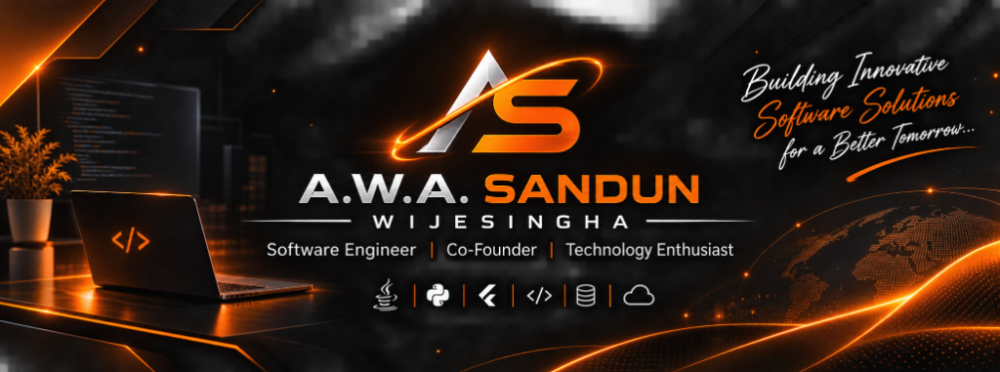
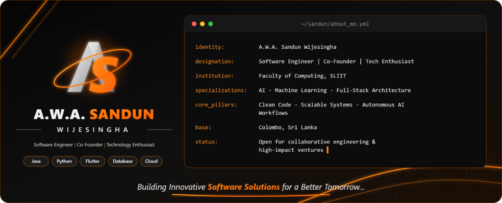
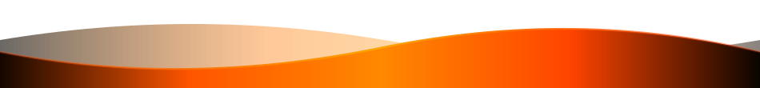

<!-- Custom Brand Banner -->

  

<!-- Neon Amber Typing SVG Animation (Increased font size & removed waving hand icon) -->

  

<!-- Social Connect Badges (Custom Amber / Charcoal Neon Palette) -->

  
  
  

<!-- Profile Views Counter in Neon Amber -->

  

---

 

<!-- ==================== SECTION 1: ABOUT ME ==================== -->

  

 

<!-- Pure High-Res Cyberpunk Terminal Card (Direct PNG Rendering) -->

  

 

---

 

<!-- ==================== SECTION 2: EDUCATION & CAREER JOURNEY ==================== -->

  

 

### 🚀 Co-Founder & Tech Lead &nbsp;|&nbsp; `2024 – Present`
> **Independent Software Engineering & Bespoke Digital Ventures**
* **Technical Architecture:** Architecting production-grade digital platforms from ideation to deployment.
* **Flagship Products:**
  * 🍲 **Hela Rewla Katagessama:** Traditional Authentic Restaurant & Online Food Ordering Platform.
  * 🎓 **Sinhala LMS:** Modern Educational Tuition SaaS with QR Attendance Scanner & AI Tutors.

 

### 🎓 B.Sc. (Hons) in Information Technology &nbsp;|&nbsp; `2024 – Present`
> **Sri Lanka Institute of Information Technology (SLIIT) • Faculty of Computing**
* **Degree Specialization:** Bachelor of Science Honours in Information Technology Specialized in Information Technology.
* **Core Domains & Research:** Software Engineering, Full-Stack Architecture, Machine Learning pipelines, and Distributed Systems.

 

---

 

<!-- ==================== SECTION 3: TECH STACK ==================== -->

  

 

| Category | Technologies & Tools |
| :--- | :--- |
| **Core Languages** |  |
| **Mobile & Cross-Platform** |  |
| **AI, ML & Deep Learning** |  |
| **Data Engineering & Science** |     |
| **Backend & APIs** |  |
| **Databases & Storage** |  |
| **DevOps, Cloud & Tooling** |  |

 

---

 

<!-- ==================== SECTION 4: FEATURED PROJECTS ==================== -->

  

 

<!-- Project 1: Seoul Bike Sharing Demand Prediction -->
<table align="center" width="100%" style="border: 2px solid #ff7700; border-radius: 12px; background-color: #0b0c10; margin-bottom: 25px;">
  <tr>
    <td style="padding: 24px 28px; background: linear-gradient(135deg, #101216 0%, #160d00 100%); border-radius: 10px;">
      

        <h2 style="color: #ff8c00; margin: 0; font-size: 21px; letter-spacing: 0.5px;">
          🚲 Seoul Bike Sharing Demand Prediction
        </h2>
        

          
        

      

      

        An end-to-end Machine Learning research benchmark evaluating <b>6 regression models</b> with strict chronological time-series cross-validation on 8,760 hourly records from UCI.
      

      

        
<b>⚡ Framework:</b> Scikit-Learn &bull; Pandas &bull; NumPy &bull; TimeSeriesSplit &bull; Joblib

        
<b>🏆 Benchmark Winner:</b> Random Forest Regressor (Test R² = 0.737, Test MAE = 216.80)

        
<b>📄 Academic Publication:</b> Full project research report included directly in repository

      

      

        
        &nbsp;
        
        &nbsp;
        
        &nbsp;
        
        &nbsp;
        
      

    </td>
  </tr>
</table>

 

<!-- Project 2: Sinhala LMS -->
<table align="center" width="100%" style="border: 2px solid #ff7700; border-radius: 12px; background-color: #0b0c10; margin-bottom: 25px;">
  <tr>
    <td style="padding: 24px 28px; background: linear-gradient(135deg, #101216 0%, #160d00 100%); border-radius: 10px;">
      

        <h2 style="color: #ff8c00; margin: 0; font-size: 21px; letter-spacing: 0.5px;">
          🎓 Sinhala Education LMS &amp; Tuition SaaS Platform
        </h2>
        

          
        

      

      

        A modern, production-grade Educational SaaS platform and Learning Management System designed for professional educators managing Grade 6–11 (O/L) and A/L Sinhala curriculums.
      

      

        
<b>⚡ Tech Stack:</b> React 18 &bull; TypeScript &bull; Vite &bull; Tailwind CSS &bull; Firebase Architecture

        
<b>🚀 Key Modules:</b> Live QR Gate Attendance Scanner &bull; Timed Exam Engine with Auto-Grading &bull; AI Sinhala Grammar Tutor

        
<b>👥 Multi-Role Portals:</b> Independent secure portals for Administrators, Students, and Parents

      

      

        
        &nbsp;
        
        &nbsp;
        
        &nbsp;
        
        &nbsp;
        
      

    </td>
  </tr>
</table>

 

<!-- Project 3: Hela Rewla Katagessama -->
<table align="center" width="100%" style="border: 2px solid #ff7700; border-radius: 12px; background-color: #0b0c10; margin-bottom: 25px;">
  <tr>
    <td style="padding: 24px 28px; background: linear-gradient(135deg, #101216 0%, #160d00 100%); border-radius: 10px;">
      

        <h2 style="color: #ff8c00; margin: 0; font-size: 21px; letter-spacing: 0.5px;">
          🍲 Hela Rewla Katagessama – Traditional Authentic Restaurant &amp; Food Ordering Web App
        </h2>
        

          
        

      

      

        An authentic Sri Lankan culinary platform and online dining experience crafted for <b>Hela Rewla Katagessama (හෙළ රැවුල කටගැස්ම)</b>, showcasing heritage Sri Lankan flavours, signature bites, and fresh local culinary delights.
      

      

        
<b>🍛 Culinary Experience:</b> Traditional Sri Lankan bites, Katagessama delicacies, authentic spices &amp; signature dishes

        
<b>⚡ Digital Platform:</b> Interactive dynamic food &amp; beverage menu, live dish availability, and seamless online food ordering

        
<b>🎨 Presentation:</b> Cultural rustic aesthetic combined with modern responsive food ordering workflows

      

      

        
        &nbsp;
        
        &nbsp;
        
      

    </td>
  </tr>
</table>

 

---

 

<!-- ==================== SECTION 5: GITHUB ANALYTICS ==================== -->

  

 

  <!-- Stats Card (Custom Dark & Glowing Orange) -->
  
  <!-- Top Languages (Custom Dark & Glowing Orange) -->
  

  <!-- Streak Stats (Numbers clearly rendered in Crisp White #ffffff) -->
  

 

---

 

<!-- ==================== SECTION 6: LET'S CONNECT ==================== -->

  

 

### Have a project idea, startup collaboration, or tech discussion?
**I'm always open to discussing Machine Learning architectures, Full-Stack applications, or partnering on innovative digital products.**

 

<!-- Clickable Professional Action Badges -->

&nbsp;&nbsp;

&nbsp;&nbsp;

  

<!-- Sleek Cyberpunk Status Pills -->

  
  &nbsp;
  
  &nbsp;
  

 

---

<!-- Custom Neon Orange Gradient Dual Wave Footer (Replaced Purple with Pure Orange Theme) -->

  

